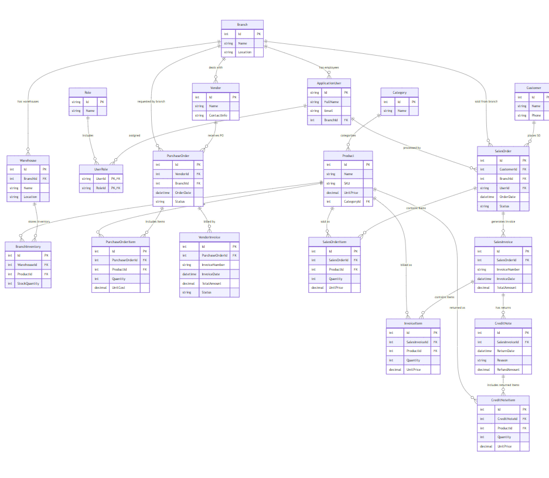

# Enterprise Procurement & Sales Management System

A web-based platform for managing end-to-end procurement workflows, multi-branch/warehouse inventory, and branch-level sales operations, built with **ASP.NET Core MVC** and **SQL Server**.

Built during a Backend Development internship at **BMW** (23 Aug – 3 Sep 2026). This was my first hands-on project with .NET. I used AI as a learning accelerator to move quickly through an unfamiliar stack, and made sure I understood the code and the business logic behind every module. It is a training project, not a production system; see [Known Limitations](#known-limitations) for what I would harden next.

## Tech Stack

| Layer | Technology |
|---|---|
| Framework | ASP.NET Core MVC (.NET 10) |
| ORM | Entity Framework Core 10 |
| Database | Microsoft SQL Server |
| Auth | Cookie authentication with claims and role-based access control (RBAC) |
| Frontend | Razor views, Bootstrap, jQuery |
| BI | Power BI dashboard |
| Test data | Python script (pyodbc, Faker, optional Groq LLM) |

## Entity-Relationship Diagram



Editable sources: [`docs/erd.drawio`](docs/erd.drawio) and [`docs/erd.mmd`](docs/erd.mmd) (Mermaid).

## Features

**Procurement & Purchasing**
- Purchase Order (PO) creation with line items (product, quantity, agreed unit cost)
- Vendor invoice processing and matching against POs

**Inventory & Multi-Branch Warehouses**
- Warehouses per branch and branch inventory tracking
- Stock availability checked at sales-order time

**Sales Operations**
- Sales Order (SO) creation and management
- Sales invoicing

**Returns & Credit Processing**
- Partial/full credit notes against sales invoices

**Access Control**
- Separate **Creator** and **Approver** roles for purchase orders and sales orders (`PO_Creator` / `PO_Approver`, `Sales_Creator` / `Sales_Approver`), plus an `Admin` role with full access
- Every page requires login

## Database

19 tables: Branches, Vendors, Products, Categories, Warehouses, BranchInventory, PurchaseOrders / Items, VendorInvoices, Customers, SalesOrders / Items, SalesInvoices, InvoiceItems, CreditNotes / Items, ApplicationUsers, Roles, UserRoles.

Full schema: [`database/schema.sql`](database/schema.sql).

## Requirements

**To run the website**
- [.NET 10 SDK](https://dotnet.microsoft.com/download)
- SQL Server (Express, LocalDB, or full) that you can connect to
- SQL Server Management Studio or Azure Data Studio (to run the schema script)
- A trusted local HTTPS certificate (first time only): `dotnet dev-certs https --trust`

NuGet packages (EF Core, etc.) restore automatically. Bootstrap and jQuery are already included under `wwwroot/lib`.

**To generate mock data (optional)**
- Python 3.10+
- [ODBC Driver 17 (or newer) for SQL Server](https://learn.microsoft.com/sql/connect/odbc/download-odbc-driver-for-sql-server)
- Python packages: see [`data_generator/requirements.txt`](data_generator/requirements.txt)

## Getting Started

### 1. Clone the repo

```bash
git clone https://github.com/<your-username>/<your-repo-name>.git
cd <your-repo-name>
```

### 2. Create the database

Run [`database/schema.sql`](database/schema.sql) against your SQL Server instance. It creates the `EnterpriseProcurementSalesDb` database and all 19 tables (empty).

### 3. Point the app at your SQL Server

The connection string is currently set in `Models/EnterpriseProcurementSalesDbContext.cs` (inside `OnConfiguring`). Replace the server name with your own instance:

```csharp
"Server=YOUR_SERVER\\SQLEXPRESS;Database=EnterpriseProcurementSalesDb;Trusted_Connection=True;TrustServerCertificate=True;"
```

Examples of `YOUR_SERVER`: `localhost`, `.`, `(localdb)\\MSSQLLocalDB`.

### 4. Add data

**Option A: generate mock data (recommended)**

```bash
cd data_generator
python -m venv .venv
.venv\Scripts\activate            # Windows  (macOS/Linux: source .venv/bin/activate)
pip install -r requirements.txt
copy .env.example .env            # macOS/Linux: cp .env.example .env
# edit .env with your SQL Server name (and a Groq API key if you want USE_LLM=true)

python main.py --dry-run          # generate and validate only, nothing inserted
python main.py                    # generate and insert into the database
python main.py --reset            # wipe existing data first, then insert
```

The script reads the live schema, works out the table dependency order, and fills all 19 tables with relationally valid data. Without a Groq key it falls back to Faker automatically.

**Option B:** create rows by hand through SQL or the app itself.

### 5. Run the app

From the repository root:

```bash
dotnet restore
dotnet run
```

Open the URL printed in the console (default: `http://localhost:5056`, or `https://localhost:7257`).

### 6. Log in

Mock users get random passwords. Look one up in SQL Server:

```sql
SELECT u.Username, u.Password, r.Name AS Role
FROM ApplicationUsers u
JOIN UserRoles ur ON ur.UserId = u.Id
JOIN Roles r ON r.Id = ur.RoleId;
```

Pick an `Admin` user to see every module, or a Creator / Approver user to try the approval workflow.

## Project Structure

```
├── Controllers/            MVC controllers (one per entity + Account, Home)
├── Models/                 EF Core entities and DbContext
├── Views/                  Razor views
├── wwwroot/                Static files (Bootstrap, jQuery, CSS, JS)
├── database/schema.sql     SQL Server schema (19 tables)
├── data_generator/         Python mock-data generator
├── docs/                   ERD (png, drawio, mermaid)
├── powerbi/                Power BI dashboard notes (file is in Releases)
├── Program.cs              App startup, auth, DB registration
└── EnterpriseSystem.csproj
```

## Power BI Dashboard

The `.pbix` file is about 64 MB, so it is published under [Releases](../../releases) instead of the repository. Open it in Power BI Desktop and point it at your own database.

The dashboard ("BMW Enterprise Dashboard") shows:
- KPIs: total sales orders, total sales, credit notes, customer count
- Top 10 vendors by cost
- Sales trend over time
- Total sales by branch
- PO status breakdown
- Best-selling products
- PO cost by category

with filters for branch and date range.

## Known Limitations

Built in about two weeks as a first .NET project, so honestly:

- **Passwords are stored in plain text.** Next step: hash them (BCrypt or ASP.NET Core Identity) before any real use.
- The database connection string is hard-coded in the `DbContext` instead of being read from `appsettings.json` / user secrets.
- Auth is a custom cookie/claims implementation rather than ASP.NET Core Identity.
- Branch-level data isolation is enforced for stock checks, but not automatically on every list/query.
- No service/repository layer; controllers talk directly to the `DbContext`.
- No automated tests for the web app.

## License

Personal training project, shared for learning purposes.
